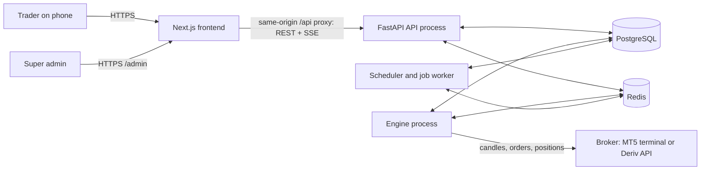
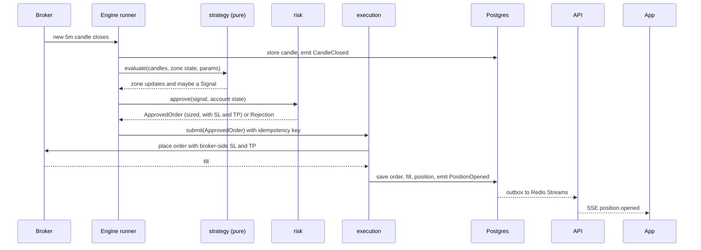

# 03. System Architecture

## 1. Style: modular monolith, microservice-ready

Megatron is **one codebase and one repository**, split into **modules with strict boundaries**, and deployed as a **small number of processes**. Real microservices would add network failures, distributed transactions and deployment work that a trading system with one team does not need yet. The module boundaries are drawn so that any module can later become its own service without a rewrite.

Rules that keep it splittable:

- Each module owns its tables (one Postgres **schema per module**) and never reads or writes another module's tables.
- Modules talk through **typed service interfaces** (synchronous, in-process) or **domain events** (asynchronous).
- Import rules are **enforced in CI** (import-linter), so a stray cross-module import fails the build.

## 2. System context



## 3. Processes (entry points)

All four run from the same codebase.

| Process | Responsibility | Never does |
|---|---|---|
| **api** | HTTP and SSE for the app and admin. Auth, settings, reads, and **commands** (start, stop, kill). | Place orders or talk to the broker for trading |
| **engine** | Always-on asyncio service. Pulls candles, runs the strategy, applies risk, executes orders, reconciles. One runner per (broker account, symbol). | Serve HTTP to users |
| **worker** | Background jobs: backtests, report generation, email, push. | Trade |
| **scheduler** | Periodic jobs: reconciliation sweeps, candle backfill, cleanup, daily reset of risk counters. | Trade |

The API and engine communicate **through the database and Redis**, not by calling each other:

- The API writes a row in `execution.commands` (for example `kill`), then publishes a Redis notification. The engine acts on the notification **and** polls the table every second, so a lost notification cannot delay a kill switch.
- The engine writes state (`bot_state`, heartbeats, positions) and publishes events. The API reads state and streams events to the app.

## 4. Modules

| Module | Owns | Public interface (examples) |
|---|---|---|
| `identity` | users, credentials, sessions, 2FA, roles | `authenticate()`, `require_role()`, `issue_step_up()` |
| `admin` | admin-only use cases (no tables of its own except flags) | user suspension, platform halt |
| `brokers` | broker accounts, encrypted credentials, adapters | `BrokerAdapter` protocol, `link_account()`, `verify_account()` |
| `marketdata` | candles, symbol specs, feed health | `get_candles()`, `subscribe_closed_candles()` |
| `strategy` | zones, signals, strategy parameters. **Pure logic, no I/O** | `evaluate(candles, state, params) -> decisions` |
| `risk` | limits, sizing, veto, kill switch state | `approve(signal, account_state) -> ApprovedOrder or Rejection` |
| `execution` | commands, orders, fills, reconciliation | `submit(ApprovedOrder)`, `close_position()`, `reconcile()` |
| `portfolio` | positions, trades, P&L, performance | `get_positions()`, `performance(period)` |
| `backtest` | backtest runs and results | `run_backtest(config)` |
| `notifications` | notifications, preferences, push subscriptions | `notify(user, kind, payload)` |
| `audit` | append-only audit log | `record(actor, action, target, metadata)` |
| `core` (shared kernel) | config, db, security primitives, event bus, outbox, logging | not a business module |

Allowed dependency direction (higher depends on lower, never the reverse):

```
api / engine / worker / scheduler   (entry points)
        |
admin, portfolio, backtest, notifications
        |
execution  ->  risk  ->  strategy
        |         |
     brokers   marketdata
        |
identity, audit
        |
core
```

`strategy` depends on nothing except `core` types. That is what lets the same strategy code run in backtest, paper and live.

## 5. Communication

**Synchronous (in-process):** typed service interfaces, for example `risk.approve(signal, state)`.

**Asynchronous domain events**, delivered through a **transactional outbox** in Postgres, then published to **Redis Streams**:

`CandleClosed`, `ZoneDetected`, `ZoneQualified`, `ZoneInvalidated`, `SweepDetected`, `SignalGenerated`, `OrderRequested`, `OrderSubmitted`, `OrderFilled`, `OrderRejected`, `PositionOpened`, `PositionClosed`, `RiskLimitBreached`, `KillSwitchActivated`, `BotStateChanged`, `BrokerDisconnected`, `ReconciliationMismatch`.

The outbox guarantees an event is published if and only if the database transaction that caused it committed. Consumers are idempotent (they track the last processed event ID).

**Realtime to the app:** one **Server-Sent Events** stream (`GET /v1/stream`) fed from Redis. Commands go back over normal REST calls.

## 6. A trade, end to end



## 7. Deployment topologies

| Environment | Layout |
|---|---|
| **Local development** | Postgres and Redis in Docker Compose. API, worker and scheduler run natively or in Docker. The engine runs **natively**: if the broker is MetaTrader 5, the engine needs the MT5 terminal and the Windows-only `MetaTrader5` Python package on the same machine. Next.js dev server for the frontend, opened on a phone through the local network or a tunnel. |
| **Production (target)** | Engine on an always-on VPS, close to the broker's servers (Windows if MT5 is used). API, worker, scheduler and frontend on a managed platform or the same VPS. Managed Postgres with backups. Managed Redis with persistence. |

### Hosting note: Render free tier

Render's free tier is fine for the **frontend** and for short API demos, but **not** for the engine or the database:

| Free-tier limitation | Impact |
|---|---|
| Web service spins down after 15 minutes without inbound traffic, and takes about a minute to wake | The engine must watch the market continuously |
| Render may restart a free service at any time | A restart during a trade drops in-memory state |
| Filesystem is ephemeral, no persistent disk on free | Local files and SQLite are lost |
| Free Postgres expires after 30 days, has no backups, deleted after a 14-day grace period | Trade history, users and encrypted keys would be lost |
| Free Key Value is in-memory only | Queues and cached state vanish on restart |
| Only web services are free: no background workers, no shell, no one-off jobs | The engine, worker and scheduler need paid plans |
| Possible suspension for high service-initiated traffic | A constant broker and data feed is exactly that |
| Outbound SMTP ports 25, 465 and 587 are blocked | Use an HTTP email API instead |

Build and test on free tiers if you like. Move the engine and database to paid, always-on infrastructure before Live trading. Also: **MetaTrader 5 cannot run on Render**, so an MT5-based engine needs a Windows VPS regardless.

## 8. Scaling and the path to services

1. Today: one engine process runs all runners.
2. Next: several engine processes, each owning a set of accounts. Ownership is a row-level lease in Postgres (`engine_leases`), so two processes never trade the same account.
3. If needed: split `execution` plus the broker adapters into their own service first, since they are the most latency and uptime sensitive. `marketdata` is second. Because modules already communicate through interfaces and events, this is a deployment change.

## 9. Failure modes and responses

| Failure | Response |
|---|---|
| Engine crashes with open positions | Broker-side SL and TP still protect them. On restart the engine **reconciles** with the broker before any new entry. |
| Broker times out after an order was sent | The order is treated as **unknown**. The engine looks it up by its idempotency key before retrying. Never blindly resend. |
| Duplicate fill or event | Consumers are idempotent. Fills are keyed by broker deal ID. |
| Candle feed stale or gapped | Fail closed: no new entries on that symbol, alert, backfill, resume only when the feed is healthy. |
| Database unavailable | Engine stops opening trades, keeps managing existing positions through the broker, and alerts. |
| Redis unavailable | API stream degrades to polling. Commands still work through the table. |
| Clock skew or wrong broker timezone | Adapter normalises all timestamps to UTC. Startup self-check compares broker time with system time and refuses to trade beyond a tolerance. |
| Reconciliation mismatch | Halt new entries on the account, alert, attempt automatic repair, and require acknowledgement if repair is not possible. |
| Daily loss limit reached | Risk module halts the account until the next trading day and notifies. |
| Engine heartbeat missing | Watchdog marks the bot `error`, notifies the user and admin. Protective stops remain at the broker. |

## 10. Observability

- Structured JSON logs with a correlation ID per candle and per order. Secrets are never logged.
- Metrics: feed latency, candle lag, order latency, rejects, reconciliation mismatches, heartbeat age, risk vetoes by reason.
- Traces across API request to command to engine action.
- Error tracking, and alerts on the failure modes above.
