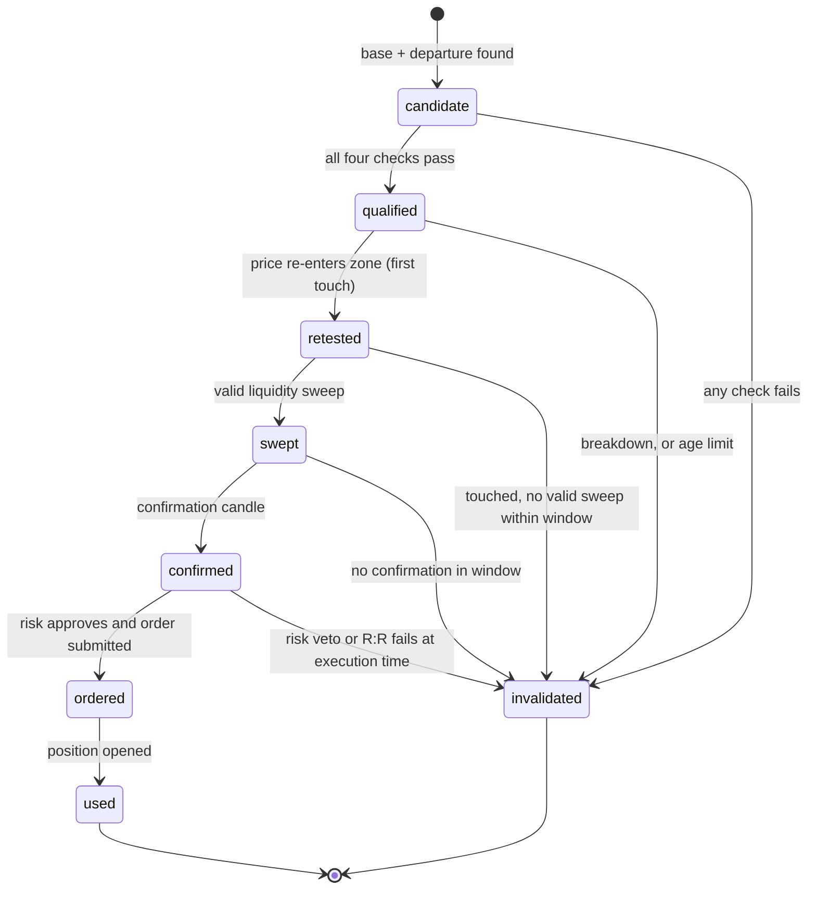
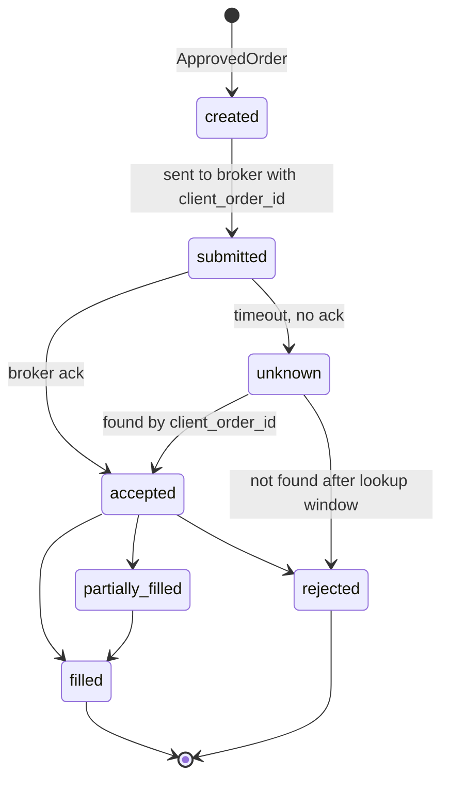

# 04. Backend Design

Companion to [03-system-architecture.md](03-system-architecture.md). The trading rules themselves live in [02-strategy-spec.md](02-strategy-spec.md).

## 1. Conventions

- **IDs:** UUIDv7 (time-ordered).
- **Time:** UTC, `timestamptz`. Candle timestamps are the **open time** of the candle.
- **Money and prices:** `NUMERIC` in Postgres, `Decimal` in Python, **decimal strings** in the API. Indicator maths (ATR, ratios) may use float64, but every price that goes into an order is a `Decimal` quantised to the symbol's tick size.
- **Postgres schemas:** one per module: `identity`, `brokers`, `marketdata`, `strategy`, `risk`, `execution`, `portfolio`, `backtest`, `notifications`, `audit`, `core`.
- **Multi-tenant ready:** every user-owned table has `user_id`, and every query filters by it.
- **Soft delete** only where history matters (users, broker accounts). Trades, orders, fills and audit rows are never deleted.

## 2. Data model (key tables)

Columns shown are the important ones. Add `id`, `created_at`, `updated_at` to every table.

### identity

| Table | Key columns |
|---|---|
| `users` | email (unique, lower-cased), password_hash (Argon2id), role (`user` or `super_admin`), status (`pending`, `active`, `suspended`, `locked`, `deleted`), email_verified_at, pin_hash, failed_login_count, locked_until |
| `sessions` | user_id, device_label, ip, user_agent, last_seen_at, revoked_at, step_up_until |
| `refresh_tokens` | session_id, token_hash, family_id, used_at, expires_at (rotating, reuse detection) |
| `totp_secrets` | user_id, secret_encrypted, confirmed_at |
| `recovery_codes` | user_id, code_hash, used_at |
| `login_events` | user_id, outcome, ip, device, at |

### brokers

| Table | Key columns |
|---|---|
| `broker_accounts` | user_id, broker_key (`exness`, `fbs`, `deriv`, ...), protocol (`mt5`, `deriv_ws`), account_login_masked, server, mode_supported, status (`pending`, `connected`, `error`, `disconnected`), permissions_verified (bool), last_synced_at, latency_ms |
| `broker_credentials` | broker_account_id, ciphertext, nonce, wrapped_dek, key_version. **Never selected by API code.** Only the adapter layer decrypts. |
| `symbol_map` | broker_account_id, canonical_symbol (`XAUUSD`), broker_symbol (`XAUUSDm`), tick_size, tick_value, contract_size, volume_min, volume_step, volume_max, digits, verified_at |

### marketdata

| Table | Key columns |
|---|---|
| `candles` | broker_account_id or feed_id, symbol, timeframe (`5m`), open_time, open, high, low, close, volume, spread_points, is_closed. Unique on (feed, symbol, timeframe, open_time). |
| `feed_status` | feed, symbol, last_candle_time, lag_seconds, status |

### strategy

| Table | Key columns |
|---|---|
| `strategy_params` | user_id, symbol, params (JSONB, validated against a schema), version |
| `zones` | user_id or feed scope, symbol, pattern (`DBR`, `RBD`, `RBR`, `DBD`), type (`demand`, `supply`), proximal, distal, formed_at, base_start, base_end, state, invalid_reason, checks (JSONB: big_candles, fresh, structure_break, rr_ok with the measured values), atr_at_formation |
| `signals` | zone_id, user_id, symbol, direction, sweep (JSONB), confirmation_type, planned_entry, planned_sl, planned_tp, planned_rr, status (`pending_approval`, `approved`, `rejected`, `vetoed`, `ordered`, `expired`), veto_reasons |

### risk

| Table | Key columns |
|---|---|
| `risk_settings` | user_id, risk_per_trade_pct, max_daily_loss_pct, max_open_trades, max_trades_per_day, max_spread_ratio, loss_streak_limit, cooldown_minutes, daily_profit_lock_pct, min_rr (system-locked at 3.0), require_approval (semi-auto) |
| `risk_state` | user_id, trading_day, realised_pnl, trades_count, loss_streak, halted_until, halt_reason |

### execution

| Table | Key columns |
|---|---|
| `bot_state` | user_id, broker_account_id, mode (`paper`, `live`), status (`stopped`, `running`, `paused`, `error`, `setup_required`), enabled_symbols, halted_reason, started_at |
| `commands` | user_id, kind (`start`, `pause`, `resume`, `stop`, `kill_halt`, `kill_flatten`, `set_mode`, `close_position`, `close_all`, `modify_position`), payload, issued_by, status (`pending`, `acked`, `done`, `failed`), acked_at |
| `orders` | user_id, broker_account_id, signal_id, client_order_id (**unique**, idempotency key), symbol, side, volume, entry_price_planned, sl, tp, status (`created`, `submitted`, `accepted`, `partially_filled`, `filled`, `rejected`, `cancelled`, `unknown`), broker_order_id, reject_reason |
| `order_events` | order_id, kind, payload, at (append-only) |
| `fills` | order_id, broker_deal_id (**unique**), price, volume, commission, swap, at |
| `engine_heartbeats` | engine_id, at, runners (JSONB with per-runner status and lag) |
| `engine_leases` | broker_account_id, engine_id, expires_at |

### portfolio

| Table | Key columns |
|---|---|
| `positions` | user_id, order_id, symbol, side, volume, entry, sl, tp, opened_at, status (`open`, `closed`), unrealised_pnl (cached), tags (JSONB) |
| `trades` | position_id, closed_at, exit, close_reason (`tp`, `sl`, `manual`, `kill_switch`, `risk_halt`, `broker_closed`, `reconciliation`), pnl, r_multiple, duration_s, spread_at_entry, slippage, manual_interventions (count), note |
| `equity_snapshots` | user_id, at, balance, equity |

### backtest, notifications, audit, core

| Table | Key columns |
|---|---|
| `backtest_runs` | user_id, symbol, from, to, params_snapshot, cost_model, status, metrics (JSONB), code_version |
| `backtest_trades` | run_id, the same fields as `trades` |
| `notifications` | user_id, kind, title, body, payload, read_at |
| `notification_prefs` | user_id, kind, channel flags (in_app, push, email), quiet_hours |
| `push_subscriptions` | user_id, endpoint, keys |
| `audit_log` | actor_id, actor_role, action, target_type, target_id, metadata, ip, at. **Append-only** (revoke UPDATE and DELETE). |
| `core.outbox` | aggregate, event_type, payload, created_at, published_at |

## 3. Zone state machine



Notes:

- A zone is **fresh** only in `candidate` and `qualified`. The first touch is the one and only entry chance.
- Every transition is stored (`zone_events`) with the measured values, so the UI can show why a zone passed or failed.
- Zones expire after `max_zone_age_candles` (assumption: 500).
- Overlapping zones: keep the one with the better R:R, mark the other `invalidated(overlap)`. (This resolves an ambiguity from strategy section 9 and must be confirmed.)

## 4. Order lifecycle



An `unknown` order **blocks new entries on that symbol** until resolved.

## 5. Risk manager

Inputs: a `Signal`, account state (balance, equity, open positions, today's realised P&L, spread, symbol spec), and `risk_settings`. Output: an **`ApprovedOrder`** (the only type `execution` accepts) or a **`Rejection`** with reasons.

Checks, in order. The first failure rejects:

1. Bot status is `running` and mode matches the account.
2. Symbol enabled and inside its allowed session.
3. Feed healthy and candle fresh.
4. No `unknown` order and no reconciliation mismatch on the account.
5. One open trade per symbol.
6. Max open trades (global).
7. Max trades per day.
8. Daily loss limit not reached, daily profit lock not reached.
9. Loss-streak cooldown not active.
10. Spread within `max_spread_ratio` of the planned risk distance.
11. **Correlation cap:** XAUUSD and GBPUSD both move with the dollar, so a cap on same-direction USD exposure applies (assumption: at most one of them open in the same USD direction by default).
12. Recompute R:R with live bid and ask. It must be at least `min_rr` (3.0, locked).
13. Size the position. Reject if the minimum lot already exceeds the allowed risk.
14. Margin check.

**Position sizing:**

```
risk_amount   = equity * risk_per_trade_pct
stop_ticks    = |entry - sl| / tick_size
loss_per_lot  = stop_ticks * tick_value        (use the broker's loss tick value)
volume_raw    = risk_amount / loss_per_lot
volume        = floor_to_step(volume_raw, volume_step), then clamp to [volume_min, volume_max]
reject if volume == 0, or if volume_min would risk more than the allowed amount
```

Order construction: stop is placed beyond the confirmation candle's extreme plus a spread buffer (use the ask for sell stops). Prices are quantised to tick size.

## 6. Engine runner

One asyncio task per (broker account, symbol):

1. Wait for a **closed** 5-minute candle (detected by the next candle's open or by server time plus the interval, never the forming candle).
2. Validate it: no gap, no duplicate, timestamp normalised to UTC.
3. Update indicators, then call `strategy.evaluate(...)`, which returns zone transitions and at most one signal.
4. Persist transitions and emit events.
5. If there is a signal: semi-auto mode creates a `pending_approval` signal and notifies the user. Auto mode goes straight to risk.
6. On `ApprovedOrder`: execution submits it.
7. Heartbeat every few seconds.

Between candles the runner also handles commands, position monitoring, and the reconciliation timer.

## 7. Strategy parameter registry

All tunables live in config (per symbol, validated, versioned). Defaults come from [02-strategy-spec.md](02-strategy-spec.md) section 8. Anything marked (assumption) is a starting point for backtesting.

| Parameter | Default | Source |
|---|---|---|
| `timeframe` | 5m | Source video |
| `atr_period` | 14 | (assumption) |
| `base_max_candles` | 6 | (assumption) |
| `base_candle_max_range_atr` | 0.5 | (assumption) |
| `departure_min_atr` | 1.5 | (assumption) |
| `departure_max_wick_ratio` | 0.30 | (assumption) |
| `swing_fractal_len` | 5 | (assumption) |
| `min_rr` | 3.0 (locked) | Source video |
| `sweep_max_reclaim_candles` | 3 | (assumption) |
| `sweep_max_depth_atr` | 1.0 | (assumption) |
| `sweep_min_buffer` | spread plus small tick buffer | (assumption) |
| `pin_wick_min_ratio` | 0.60 | (assumption) |
| `pin_body_max_ratio` | 0.30 | (assumption) |
| `doji_body_max_ratio` | 0.10 | (assumption) |
| `confirmation_types_enabled` | pin, tailed, doji, engulfing | Source video |
| `max_zone_age_candles` | 500 | (assumption) |
| `stop_buffer` | spread plus 0.1 ATR | (assumption) |
| `max_spread_ratio` | 0.10 of risk distance | (assumption) |
| `entry_mode` | market at next open | (assumption) |

Per-symbol overrides allowed for every parameter. Session filters are per symbol (see section 10 of the strategy spec).

## 8. Backtest rules

- Same `strategy.evaluate` and `risk` code as live. Only the broker is a **simulated broker**.
- **No look-ahead:** the strategy only ever receives candles up to the current one. A test proves that changing future candles does not change earlier decisions.
- Fill model: market order fills at the next candle's open plus spread plus a slippage model. Pending-order style entries are not used.
- If SL and TP are both inside one candle, assume **SL first** (conservative), unless lower-timeframe (1 minute) data is supplied to decide.
- Costs: per-symbol spread (historical if available, else a configured average), commission, swap.
- Output: trade list, equity curve, win rate, profit factor, average R, max drawdown, per instrument and per session, plus the exact parameters and code version, so a run can be reproduced.

## 9. Notifications

Kinds: `trade_opened`, `trade_closed`, `zone_ready`, `sweep_detected`, `signal_pending_approval`, `daily_loss_limit_hit`, `broker_disconnected`, `bot_error`, `reconciliation_mismatch`, `new_login`, `account_suspended`. Channels: in-app, then web push, then email (HTTP email API, since SMTP ports are blocked on some hosts).

## 10. Audit

Record: login success and failure, 2FA changes, password changes, broker linked or removed, mode changes, bot start and stop, kill switch, risk setting changes, manual position actions, every admin action, and every step-up authentication. Audit rows never contain secrets.
